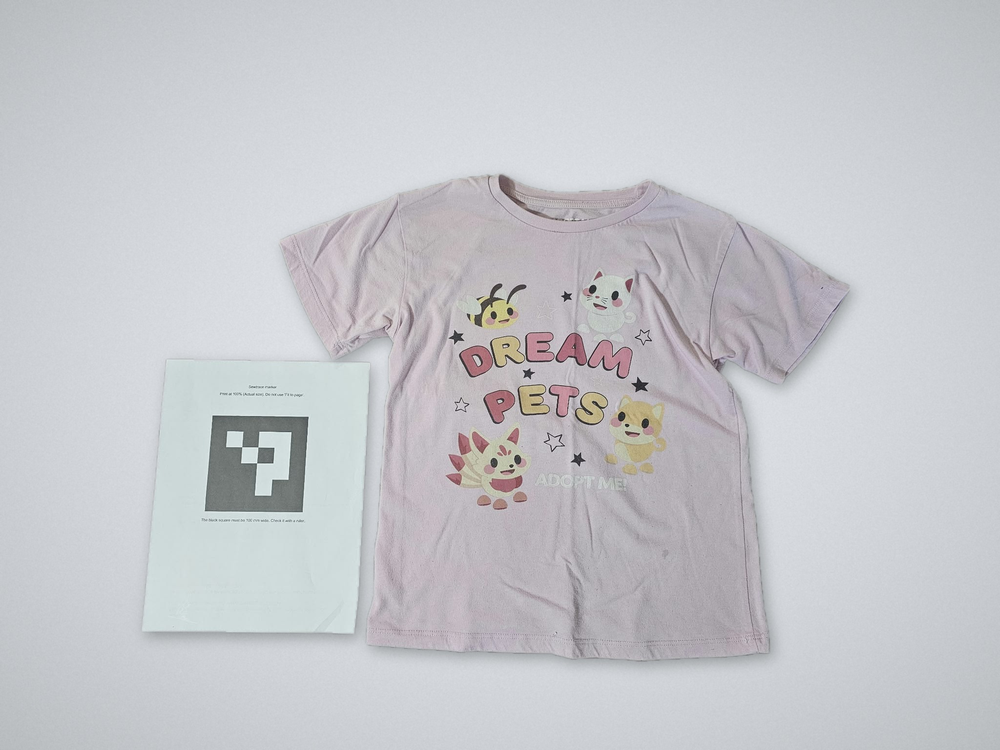
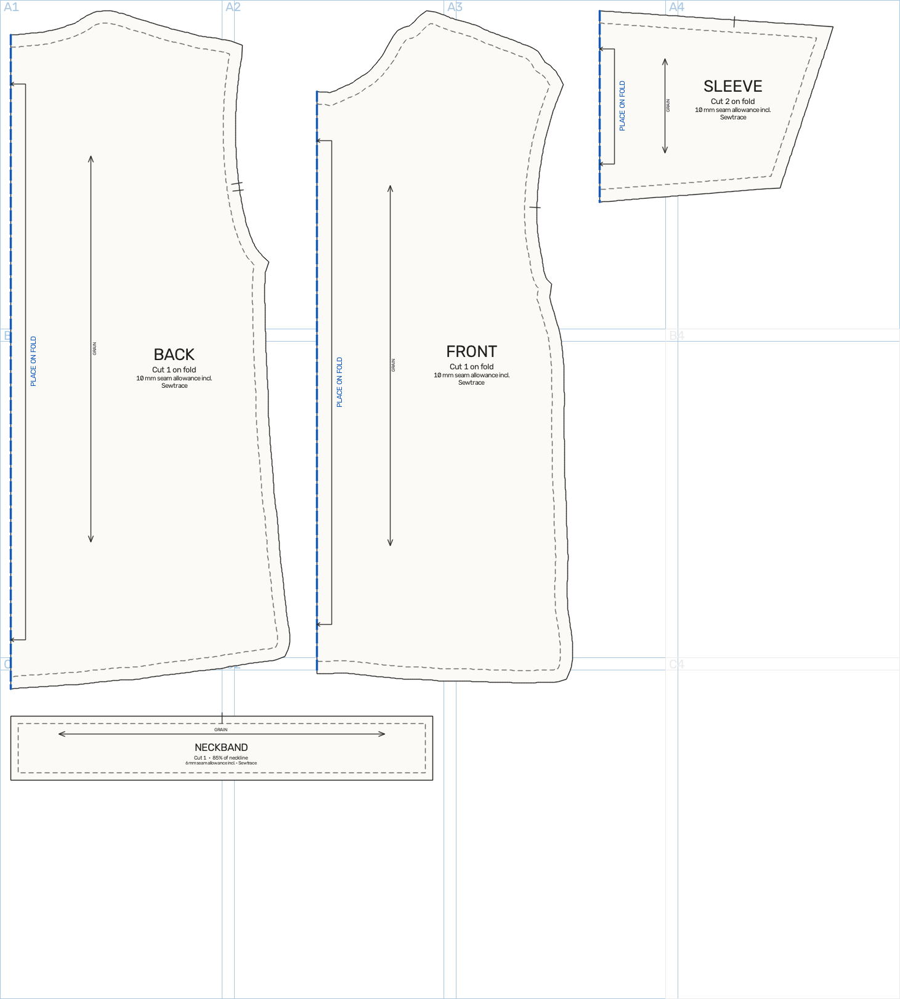

# Sewtrace

Three photos of a kid's t-shirt in, a 1:1 sewing pattern out, checked to sew together.

Sewtrace is built for the Meta Global AI Developer Hackathon 2026 (Indie track).
It uses only Meta models, through the Meta Model API.

| The t-shirt (front photo) | The pattern Sewtrace made |
| --- | --- |
|  |  |

[Watch the demo (2:47, with voice-over)](docs/sewtrace_demo.mp4). It is a screen recording of the real web page: upload three photos, run, seam check, pattern studio, export, cut plan and a Co-pilot edit, plus a photo of the printed pattern laid on the real t-shirt (a visual comparison, not measured).
The recorded run on this t-shirt: 1 Muse Spark call, 3 SAM masks, $0.027, all 4 seam pairs matching.
The photo backgrounds in the demo and in the image above were replaced with a plain backdrop for presentation. The pattern image and the numbers below come from the original photos, taken on a floor.

## What it does

You lay a t-shirt flat next to a printed 100 mm marker. You take a front photo, a back photo and a sleeve photo.
Sewtrace returns a tiled A4 PDF at 1:1 scale, plus SVG and DXF files.
Page 1 of the PDF has a 100 mm test square, so you can check the print scale.

A run has eight steps:

```
3 photos + 100 mm ArUco marker
  1. Marker detection + homography (px to mm)       sewtrace/vision/marker.py
  2. SAM 3.1 masks (t-shirt, sleeve)                 sewtrace/api/client.py
  3. Contours, smoothing, symmetry, edges (mm)       sewtrace/vision/contour.py
  4. Six measurements                                sewtrace/vision/measure.py
  5. Muse Spark 1.3: panel spec JSON                 sewtrace/reason/panels.py
  6. Seam check + code fix                           sewtrace/reason/seams.py
  7. Tiled A4 PDF, SVG, DXF                          sewtrace/output/
  8. Proof: paper-on-t-shirt photo, edge gap in mm   sewtrace/vision/verify.py
```

Sewtrace never exports a pattern that fails a seam pair.

The same pattern also becomes manufacturing files (`sewtrace/output/manufacture.py`, code only, no model call):
a cut plan with every piece nested on a fabric roll, an ordered cut path, a bill of materials, assembly
instructions and one zip of the run. The cutter profile is illustrative, a sample, not a real machine.

## Why Meta models

The models feed each other two times (SPEC sections 6 and 15).

1. SAM 3.1 makes the first outline of the t-shirt from a text prompt.
2. Muse Spark 1.3 adds the geometry that the camera cannot see: the front and back neck depths and the grain line.
   It also proposes a sleeve cap curve. With the default `cap_style = "flat"` (`sewtrace/config.toml`), code
   replaces that curve with a straight sleeve top, as long as the arm hole needs.
3. Seam pairs that do not match are fixed by code. With the default flat sleeve top this needs no model call.
   The optional `cap_style = "curve"` asks Muse Spark for a new cap shape, at most 3 calls, before the code fix.
4. The Co-pilot turns a plain request, such as "make it 2 cm longer", into one Muse Spark proposal. Code applies it and checks every seam again.
5. SAM 3.1 then measures the printed result, on the proof photo.

Without SAM, there is no outline and no proof. Without Muse Spark, there is no hidden geometry and no Co-pilot.
Every model call goes through one client, `sewtrace/api/client.py`.

A run is cheap: about $0.21 in the worst case (SPEC section 8.1), $0.027 on the real run above.
Sewtrace also says no. A bad photo is refused with the reason and how to retake it, and a pattern that fails a seam pair is never exported.

## Results

All numbers below come from synthetic t-shirts (`sewtrace/mock/synth.py`).
The synthetic t-shirts have known geometry. In mock mode the SAM masks and the model answers are stand-ins.
So these numbers test the geometry code. They do not test SAM or Muse Spark.

**Synthetic clean set** (5 t-shirts, `sewtrace eval`, mock mode, 0 paid calls):

| Garment | Mean absolute error (mm) | Seams |
| --- | --- | --- |
| tee1 | 0.36 | all ok |
| tee2 | 0.44 | all ok |
| tee3 | 0.33 | all ok |
| tee4 | 0.23 | all ok |
| tee5 | 0.43 | all ok |
| **All runs** | **0.36** | **0 of 5 runs failed** |

The worst single measurement is 1.28 mm (shoulder width of tee2). The target is a mean of 0.5 mm or less.

**Synthetic hard set** (wavy edges, rounded corners, stray blobs, a 3 to 10 degree shoulder kink, mock mode):

| Garment | Result |
| --- | --- |
| tee3 (10 degree kink) | mean error 1.91 mm, shoulder width 8.0 mm, all seams pass |
| tee8 (10 degree kink) | mean error 0.64 mm, all seams pass |
| tee1 (3 degree kink) | refused: "shoulder point is not clear" (spread 58 mm, limit 40 mm) |

Sewtrace refuses a photo when the sleeve top and the shoulder seam are nearly in line.
It names the photo and tells you how to take it again. It does not guess.
The shoulder width error is the weak point on hard tees.

**Synthetic proof photos** (paper cut from the pattern, laid on the t-shirt):

- A perfect paper gives a mean edge gap of 0.08 mm (tee1) and 0.04 mm (tee3).
- Tests check that a paper that is 2% too big, or shifted by 4 mm, reads within 0.5 mm of the exact gap.
- Sewtrace refuses a paper fold that bows 8 mm or more. It asks you to take the proof photo again. Bows of 3 and 5 mm are absorbed. Tested on folds of 320, 480 and 700 mm, at bows of 3, 5, 8, 12 mm (and 8 mm bowed the other way). The limit is a share of the fold length (`fold_bow_limit_frac` in `config.toml`).

**Real proof photo: not working yet.** On a real photo SAM 3.1 masks only the t-shirt it can see, not the part under the paper.
The underarm corners are hidden, so the check stops with "found no underarm corners".
The `paper` prompt also picked the marker sheet instead of the pattern paper.
A planned fix: one photo of the t-shirt alone and one with the paper on it, without moving either, aligned by the marker.

**Real t-shirt run (pink child's tee, three phone photos, REAL mode).**

| Item | Result |
| --- | --- |
| Models | SAM 3.1 (3 masks), Muse Spark 1.3 (1 call) |
| Cost | $0.027 (the SAM answers were already cached) |
| Seam check | First pass failed 3 of 4 pairs (side seam off by 29.8 mm). One pair fix and the final check pass: all 4 pairs match |
| Chest width | 378.8 mm (averaged front/back) |
| Body length | 515.8 mm |
| Shoulder width | 360.8 mm (averaged front/back) |
| Sleeve length | 133.1 mm |
| Neck width | 184.0 mm |

The photos were not laid straight (shoulder points 9 mm and 15 mm apart). Sewtrace said so and averaged both sides.
SAM sent no confidence score, so the minimum-score check was skipped.
There is no tape-measure ground truth for this tee yet, so there is no error figure for real fabric. The synthetic tables above do not cover it.
Real SAM edges, fabric that is not flat and lens distortion will add error.

## Quick start (mock mode, no key, no cost)

Fastest way to see it:

```bash
pip install -e '.[dev]' && cp .env.example .env   # no key needed: mock mode is the default
sewtrace serve                    # then open http://127.0.0.1:8000 and run the sample tee
sewtrace demo play tee1           # or play the recorded demo, no network
```

All the steps, one by one:

```bash
python -m venv .venv && . .venv/bin/activate
pip install -e '.[dev]'
cp .env.example .env            # leave META_API_KEY empty to stay mocked
python -m sewtrace.mock.synth   # writes data/synth/tee1..tee5 (each with truth.json)
sewtrace run data/synth/tee1    # pattern files in out/tee1
sewtrace eval                   # error table in out/eval/results.md
pytest
```

Check a proof photo. `sewtrace run` first, so that `verify` finds the pattern in `out/tee1`.
Then make a synthetic proof photo and check it:

```bash
sewtrace run data/synth/tee1                 # skip if you did it above
python -m sewtrace.mock.proof data/synth/tee1   # writes data/synth/tee1/proof.jpg
sewtrace verify data/synth/tee1/proof.jpg
```

The proof photo is a paper half front, cut exactly on the stitch line (scale 1.0, no shift), laid on the t-shirt.
The mean edge gap is under 0.1 mm. Add `--scale 1.02` to cut the paper 2% too big.

Change a finished pattern with a plain request (the Co-pilot). One Muse Spark call makes the proposal. Code makes the change.

```bash
sewtrace edit out/tee1 "make it 2 cm longer"          # prints the proposal. No file changes.
sewtrace edit out/tee1 "make it 2 cm longer" --yes    # applies it and writes the files again
```

Allowed requests: body length, chest width, sleeve length, overall size. The limits are in `[edits]` in `sewtrace/config.toml`.
One request costs about $0.01 in REAL mode. The same request again is served from the cache. In mock mode it costs nothing.
Every number on the page and in `measurements.json` has a source label: from photo, averaged front/back, your tape, inferred by Muse, drafted, or co-pilot edit.

Open the test page with `sewtrace serve`. Then open `http://127.0.0.1:8000`. To deploy it, read `docs/DEPLOY.md`.
In mock mode, the page works with the sample tee only.

Play the recorded demo with no network and no model call:

```bash
sewtrace demo play tee1
sewtrace demo play tee1 --check   # only check that the bundle is complete
```

## Run with the real models

REAL mode makes paid calls. Read `docs/CAPTURE.md` before you take photos.

1. Install the SAM decoder: `pip install -e '.[real]'`.
2. Put your key in the environment: `export META_API_KEY=...`. Never put it in a file in git.
3. Set `SEWTRACE_MOCK=0`. To use the web page in REAL mode, also set `SEWTRACE_WEB_PASSWORD` (the page asks for it; see `.env.example`).
4. Run the Day 1 test on one photo: `sewtrace day1 <photo> --yes-spend`. It makes two paid calls.
5. Run a garment: `sewtrace run data/raw/<tee>`.
6. Check the ledger total in `data/ledger.csv` before you run again.

## Safety and cost

- **Budget guard.** `MetaClient` stops every call that would take the ledger total over the limit in `sewtrace/config.toml` ($140).
- **Ledger.** `data/ledger.csv` records the cost of each call.
- **Cache.** `MetaClient` caches each answer by image hash, model, prompt and parameters. A repeat run costs nothing.
- **Offline mode.** `SEWTRACE_OFFLINE=1` replays answers from the cache only. The demo bundles use it.
- **No paid calls in tests.** `pytest` runs with no key and mocks every Meta call.
- **Model rule.** Only Meta models, through the Meta Model API. The contributor model is for synthetic photos only.

The estimate for one worst-case run with Muse Spark is about $0.21 (SPEC section 8.1). The target is under $0.50.
The Day 1 test replaces that estimate with a measured value.

## Project layout

| Path | Job |
| --- | --- |
| `sewtrace/api/client.py` | The only Meta client: cache, ledger, budget guard, retries |
| `sewtrace/vision/marker.py` | Marker detection and the homography (px to mm) |
| `sewtrace/vision/contour.py` | Mask to outline, sleeve removal, symmetry, labelled edges |
| `sewtrace/vision/measure.py` | The six measurements |
| `sewtrace/vision/verify.py` | Proof photo: edge gap between the paper and the t-shirt |
| `sewtrace/reason/panels.py` | Panel spec: prompt, schema, validation |
| `sewtrace/reason/seams.py` | Seam check loop |
| `sewtrace/reason/reshape.py` | Neck and sleeve cap reshaping |
| `sewtrace/reason/edits.py` | Co-pilot: plain request to proposal (one Spark call), then the change by code |
| `sewtrace/reason/provenance.py` | Where each value came from: photo, average, tape, model, draft, edit |
| `sewtrace/output/` | Tiled A4 PDF, SVG, DXF, marker PDF |
| `sewtrace/pipeline.py` | One run, from three photos to pattern files |
| `sewtrace/eval.py` | Error table against ground truth |
| `sewtrace/demo.py` | Record and play offline demo bundles |
| `sewtrace/web/` | The test page (FastAPI, one HTML page) |
| `sewtrace/mock/` | Synthetic t-shirts and proof photos for tests |
| `sewtrace/config.toml` | Models, prices, prompts, thresholds, tolerances |

## Documents

- `SPEC.md`: the requirements. The source of truth.
- `docs/CAPTURE.md`: how to take good photos.
- `docs/DEMO.md`: how to record and play the demo.
- `docs/DEPLOY.md`: how to deploy the test page.
- `docs/PROJECT.md`: the project brief.
- `docs/CONTRIBUTING.md`: module rules and mock mode.

## Status

Open items, decisions and the Day 1 results are in `docs/PROJECT.md`.
